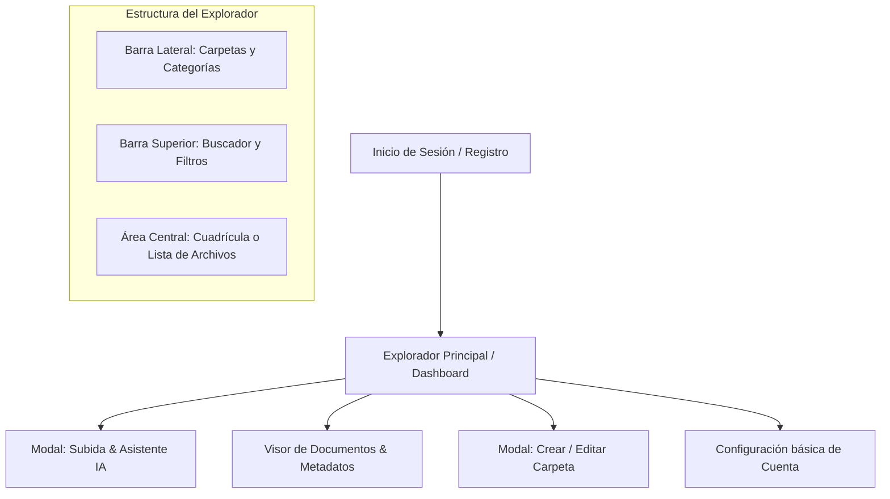

# 02 - Experiencia de Usuario (UX)

## 1. Roles de Usuario y Permisos
Para el alcance del MVP, el sistema maneja un modelo de usuario centrado en la privacidad y la gestión personal/profesional directa:

| Rol | Descripción | Permisos Principales |
| :--- | :--- | :--- |
| **Usuario Autenticado (Propietario)** | Usuario individual que administra su propio repositorio documental | • Subir, previsualizar, renombrar, descargar y eliminar sus documentos. • Crear, editar y organizar carpetas y categorías. • Gestionar etiquetas (*tags*) y metadatos. • Validar o modificar sugerencias de clasificación por IA. |
| **Usuario No Autenticado (Invitado)** | Visitante sin sesión activa | • Acceso exclusivo a pantallas de inicio de sesión (*Login*) y registro. |

---

## 2. Mapa de Navegación (Estructura de Pantallas)

---

## 3. Flujos de Interacción Principales

### Flujo 1: Subida de Documento con Clasificación Asistida por IA
1. **Inicio de la acción**: El usuario hace clic en el botón principal **"+ Subir Documento"** o arrastra archivos directamente sobre la interfaz (*Drag & Drop*).
2. **Carga y análisis**: El archivo se carga localmente y el sistema muestra un indicador visual amigable: *"Analizando documento con IA..."*.
3. **Presentación de sugerencias**:
   - El modal despliega el nombre del archivo (editable) y una sección destacada con la recomendación de la IA:
     - **Categoría sugerida**: (ej. *"Facturas & Recibos"*).
     - **Etiquetas sugeridas**: (ej. *"2026"*, *"Electricidad"*, *"Comprobante"*).
4. **Validación del usuario**: El usuario puede:
   - Aceptar las sugerencias con un solo clic en *"Aplicar sugerencias"*.
   - Modificar manualmente la categoría, agregar/quitar etiquetas o seleccionar una carpeta de destino.
5. **Confirmación**: Pulsa *"Guardar documento"*. La ventana modal se cierra, el archivo aparece de inmediato en la lista y se muestra una notificación flotante (*toast*) de éxito: *"Documento guardado y clasificado exitosamente"*.

### Flujo 2: Búsqueda, Filtrado y Visualización
1. **Búsqueda o filtrado**: 
   - El usuario escribe en la barra superior (ej. *"contrato alquiler"*) o hace clic en un filtro rápido (ej. botón *"PDF"* o etiqueta *"Legal"*).
   - La lista de resultados se actualiza en tiempo real mostrando las coincidencias resaltadas.
2. **Apertura de documento**: El usuario hace clic sobre la tarjeta o fila del archivo deseado.
3. **Visualización y detalle**: Se abre el **Visor de Documento**:
   - En el centro: previsualización legible del archivo con controles de zoom y navegación de páginas.
   - En el panel lateral derecho: panel con metadatos (formato, peso, fecha de subida, carpeta actual, categoría y etiquetas asignadas).
4. **Acciones directas**: Desde esta misma vista, el usuario puede descargar el archivo original, editar sus metadatos o eliminarlo.

### Flujo 3: Organización mediante Carpetas
1. El usuario hace clic en el botón **"Nueva Carpeta"** en la barra lateral.
2. Ingresa el nombre de la carpeta en un diálogo emergente rápido y confirma.
3. Para organizar documentos, puede arrastrarlos hacia la carpeta deseada o abrir el menú contextual (`...`) del archivo y seleccionar *"Mover a..."*.

---

## 4. Pantallas Clave y Componentes

### Pantalla 1: Explorador Principal (Dashboard)
- **Objetivo**: Ser el centro de comando visual para explorar, ordenar y localizar cualquier archivo rápidamente.
- **Elementos visibles**:
  - **Barra lateral izquierda**:
    - Acceso rápido: *"Todos los documentos"*, *"Recientes"*, *"Favoritos"*.
    - Árbol de carpetas personales jerárquicas con contador de elementos.
    - Lista de categorías del sistema/usuario con indicadores de color.
  - **Barra superior**:
    - Campo de búsqueda interactivo con soporte para texto y etiquetas (`#tag`).
    - Filtros por tipo de archivo: pastillas interactivas `[Todos]`, `[PDF]`, `[Word]`, `[Imágenes]`.
    - Selector de visualización: botón para alternar entre vista en **Cuadrícula** (tarjetas con miniaturas) y vista en **Lista** (tabla detallada).
    - Botón de acción destacada: **"+ Subir Documento"**.
  - **Área central**:
    - Contenedor dinámico de carpetas y archivos ordenables por nombre, fecha de subida o tamaño.
    - Menú contextual rápido (`...`) en cada elemento con opciones: *Ver, Renombrar, Mover, Descargar, Eliminar*.
- **Estados especiales**:
  - **Estado vacío (*Empty State*)**: Si no hay documentos cargados, se muestra una ilustración moderna con el mensaje: *"Tu espacio está listo. Sube tu primer documento o crea una carpeta para comenzar"*.
  - **Estado sin resultados de búsqueda**: *"No encontramos documentos que coincidan con '[término]'. Intenta con otros filtros o términos"*.
  - **Estado de carga (*Skeleton screens*)**: Siluetas parpadeantes que representan las tarjetas mientras se recuperan los datos.

### Pantalla 2: Modal de Subida y Asistente IA
- **Objetivo**: Permitir una carga rápida de archivos minimizando el trabajo manual de organización.
- **Elementos visibles**:
  - Zona de arrastre de archivos (*Dropzone*) con soporte para PDF, DOCX, PNG y JPG.
  - Campo para renombrar el archivo antes de guardar.
  - Selector de carpeta de destino (por defecto: *"Raíz"* o la carpeta actualmente abierta).
  - **Caja de Asistencia IA**:
    - Chip de categoría detectada con botón *"Aceptar"* o desplegable para cambiarla.
    - Chips de etiquetas sugeridas seleccionables con un clic.
  - Botones inferiores: *"Cancelar"* y *"Guardar en mi biblioteca"*.
- **Estados especiales**:
  - **Cargando/Analizando**: Barra de progreso con mensaje dinámico *"Leyendo documento y generando sugerencias inteligentes..."*.
  - **Error de formato o tamaño**: Advertencia en color ámbar/rojo si el archivo supera el límite permitido o no es un formato soportado.

### Pantalla 3: Visor de Documentos y Panel de Metadatos
- **Objetivo**: Permitir la consulta rápida de contenidos sin obligar a descargar el archivo al equipo local.
- **Elementos visibles**:
  - **Área de visualización principal (70% del ancho)**:
    - Renderizador integrado para PDF (paginación, zoom +/-), visor de imágenes de alta resolución o visor estándar de documentos Word.
    - Barra de herramientas superior del visor: botón de descarga directa, imprimir y cerrar modal (`✕`).
  - **Panel lateral de detalles (30% del ancho)**:
    - Nombre del archivo y extensión.
    - Tamaño, fecha de creación y última modificación.
    - Categoría asignada (editable en el sitio).
    - Sección de etiquetas: nube de etiquetas asignadas con botón `+ Agregar etiqueta`.
    - Botón peligroso: *"Eliminar documento"* (con diálogo de confirmación de dos pasos).
- **Estados especiales**:
  - **Archivo no previsualizable en línea**: Si un documento específico no puede renderizarse en el navegador, se muestra un icono representativo y el botón *"Descargar para ver en tu equipo"*.
