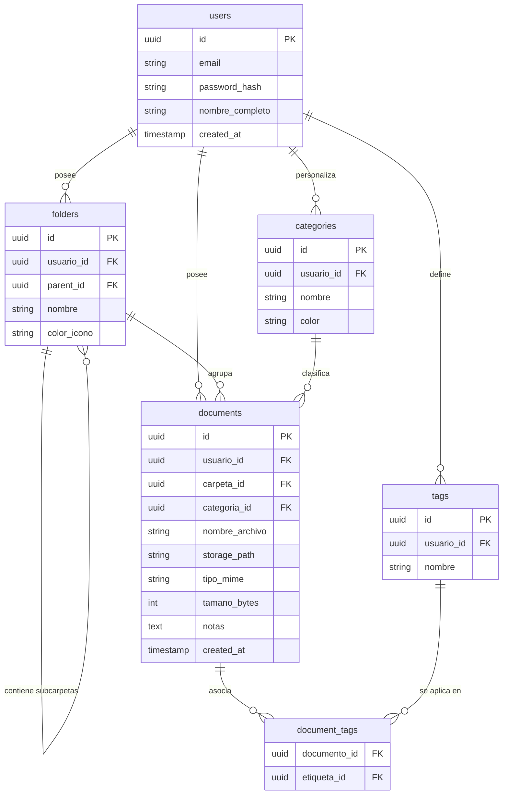

# 04 - Datos y Tecnología

Este documento define la estructura de datos conceptual y la pila tecnológica recomendada para **DocuSmart**, priorizando el estricto cumplimiento de los requisitos de **seguridad**, **privacidad**, **aislamiento por usuario** y **rendimiento**.

---

## 1. Modelo Conceptual de Datos (Entidades Clave)

### Entidades y Atributos Principales

1. **`Usuario` (`users`)**:
   - `id`: Identificador único universal (UUID, Clave Primaria).
   - `email`: Correo electrónico del usuario (único, normalizado).
   - `password_hash`: Contraseña protegida mediante algoritmo de cifrado robusto (*Argon2* o *bcrypt*).
   - `nombre_completo`: Nombre del propietario de la cuenta.
   - `created_at` / `updated_at`: Marcas de tiempo de auditoría.

2. **`Carpeta` (`folders`)**:
   - `id`: UUID (Clave Primaria).
   - `usuario_id`: Clave foránea referenciando a `users.id` (Aislamiento de propiedad).
   - `parent_id`: UUID autoreferencial (opcional, permite crear subcarpetas anidadas).
   - `nombre`: Nombre de la carpeta (ej. *"Contabilidad 2026"*).
   - `color_icono`: Código de color hexadecimal para personalización visual.
   - `created_at` / `updated_at`: Marcas de tiempo.

3. **`Categoria` (`categories`)**:
   - `id`: UUID (Clave Primaria).
   - `usuario_id`: UUID referenciando a `users.id` (o `NULL` para categorías del sistema predefinidas como *"Facturas"*, *"Contratos"*, *"Identificación"*, *"Personal"*).
   - `nombre`: Nombre de la categoría.
   - `color`: Color distintivo para la interfaz.

4. **`Documento` (`documents`)**:
   - `id`: UUID (Clave Primaria).
   - `usuario_id`: UUID referenciando a `users.id` (Garantía estricta de pertenencia).
   - `carpeta_id`: UUID referenciando a `folders.id` (Opcional, `NULL` si reside en la raíz).
   - `categoria_id`: UUID referenciando a `categories.id` (Opcional, asignada manualmente o por IA).
   - `nombre_archivo`: Nombre visible y renombrable por el usuario.
   - `nombre_original`: Nombre del archivo tal como se cargó desde el equipo.
   - `tipo_mime`: Tipo MIME verificado (ej. `application/pdf`, `image/png`).
   - `extension`: Extensión normalizada (`pdf`, `docx`, `png`, `jpg`).
   - `tamano_bytes`: Peso exacto del archivo en bytes.
   - `storage_path`: Clave privada de localización en el almacenamiento de objetos seguro (nunca accesible directamente por URL estática).
   - `notas`: Campo de texto libre para anotaciones del usuario.
   - `created_at` / `updated_at`: Marcas de tiempo.

5. **`Etiqueta` (`tags`)**:
   - `id`: UUID (Clave Primaria).
   - `usuario_id`: UUID referenciando a `users.id`.
   - `nombre`: Texto de la etiqueta (ej. *"Hacienda"*, *"Urgente"*, *"Vehículo"*).

6. **`DocumentoEtiqueta` (`document_tags`)**:
   - `documento_id`: UUID referenciando a `documents.id`.
   - `etiqueta_id`: UUID referenciando a `tags.id`.
   - *Relación N a M*: Permite que un documento tenga múltiples etiquetas y una etiqueta se comparta entre varios documentos.

---

### Diagrama Entidad-Relación (ER)

---

## 2. Pila Tecnológica Sugerida (Tech Stack)

Para cumplir cabalmente con la seguridad, el aislamiento por usuario y la visualización fluida, se propone una arquitectura moderna basada en estándares de la industria:

### 1. Frontend: Next.js (React) + TypeScript + Tailwind CSS
- **¿Por qué Next.js & React?**: Permite una interfaz moderna, ultra reactiva y modular. Su capacidad de ejecución del lado del servidor (SSR / Server Components) permite preparar datos de forma segura sin exponer lógica crítica en el navegador del cliente.
- **TypeScript**: Garantiza robustez y control estricto de tipos, previniendo errores en tiempo de ejecución al manipular metadatos y respuestas de archivos.
- **Tailwind CSS**: Permite maquetar el explorador de archivos, paneles laterales y ventanas modales de manera limpia, ligera y adaptable a cualquier pantalla.
- **Visores de Documentos**: Integración con bibliotecas optimizadas como `react-pdf` (para navegación fluida de PDFs) y componentes ligeros para previsualización directa de imágenes.

### 2. Backend & Base de Datos: PostgreSQL con Supabase (o Node.js / Express con PostgreSQL)
- **Base de Datos Relacional (PostgreSQL)**:
  - Garantiza integridad referencial estricta (si se borra una carpeta o usuario, se gestiona la integridad en cascada).
  - **Row-Level Security (RLS)**: PostgreSQL incluye políticas de seguridad a nivel de fila nativas. Esto significa que la propia base de datos impide físicamente que una consulta de un usuario acceda a registros de otro, garantizando el aislamiento de datos solicitado en la Fase 3.
- **Almacenamiento de Objetos Seguro (Object Storage compatible con S3)**:
  - Los archivos físicos (PDFs, imágenes, Word) no se guardan directamente en la base de datos, sino en un *bucket* de almacenamiento privado y cifrado en reposo (AES-256).
  - **URLs Firmadas Temporales (*Signed URLs*)**: Cuando el usuario quiere ver o descargar un documento, el backend genera una URL temporal de acceso directo que expira a los 15 minutos. Ningún archivo tiene enlace público permanente.

### 3. Servicio de Inteligencia Artificial (IA): Google Gemini API (`gemini-2.0-flash`)
- **Modelo Seleccionado**: **`gemini-2.0-flash`** (modelo multimodal oficial de última generación y alto rendimiento de Google).
- **¿Por qué este modelo específico para DocuSmart?**:
  - **Soporte multimodal nativo para documentos**: Procesa directamente archivos PDF e imágenes (JPG, PNG) sin requerir conversiones manuales intermedias ni herramientas OCR pesadas de terceros.
  - **Salidas estructuradas garantizadas (*Structured Outputs / JSON Schema*)**: Permite forzar al modelo a responder con un esquema JSON estricto (`{ "categoria_sugerida": string, "etiquetas": string[] }`), eliminando respuestas ambiguas o formatos difíciles de procesar en el backend.
  - **Velocidad y latencia ultrabaja**: Tiempos de respuesta típicos de 1 a 2 segundos, cumpliendo holgadamente el requisito de rendimiento (< 3-5 s) establecido en la Fase 3.
  - **Garantía empresarial de privacidad**: La API de Google Gemini en su modalidad de pago/desarrollo garantiza contractualmente que los archivos, imágenes y metadatos no son retenidos ni utilizados para entrenar modelos públicos.
  - **Respaldo de fallos**: Si la API externa experimenta demoras o supera límites temporales, el backend captura el evento de forma transparente y permite al usuario guardar el documento con clasificación manual sin bloquear la interfaz.

---

## 3. Integraciones Externas y Servicios Auxiliares

| Servicio | Proveedor Sugerido | Propósito |
| :--- | :--- | :--- |
| **Autenticación** | Supabase Auth / NextAuth.js | Gestión segura de registro, login, tokens JWT cifrados y sesiones seguras con cookies *HttpOnly*. |
| **Almacenamiento Seguro** | Supabase Storage / AWS S3 | Almacenamiento privado de archivos con cifrado en reposo y generación de URLs firmadas temporales. |
| **Inferencia IA** | Google Gemini API (`gemini-2.0-flash`) | Clasificación inteligente nativa de documentos (PDF, imágenes) y sugerencia de etiquetas mediante llamadas seguras con salidas JSON estructuradas. |
| **Servicio de Correo** | Resend / SendGrid (Opcional en MVP) | Verificación de correo electrónico y recuperación de contraseñas. |

---

## 4. Garantía de Cumplimiento de Seguridad y Privacidad

1. **Aislamiento a nivel de datos**: Aplicación obligatoria de `usuario_id` en todas las consultas y habilitación de directivas RLS en PostgreSQL.
2. **Protección de enlaces**: Generación de URLs firmadas de corta duración; no existen carpetas web públicas abiertas a indexación.
3. **Cifrado de extremo a extremo**: Comunicaciones forzadas sobre HTTPS/TLS 1.3 y cifrado AES-256 en reposo.
4. **Respaldo de fallos en IA**: Si la llamada a la API de IA falla o agota su cuota, el backend atrapa la excepción y retorna el documento guardado con éxito sin bloquear la experiencia de usuario.
