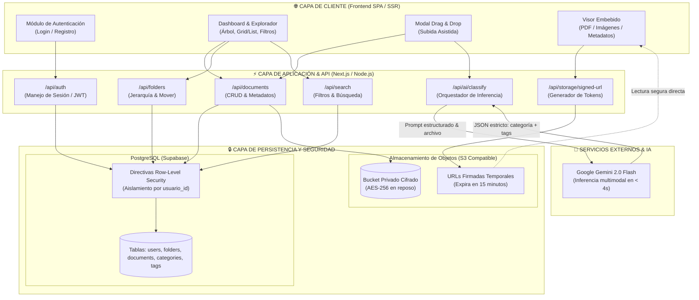
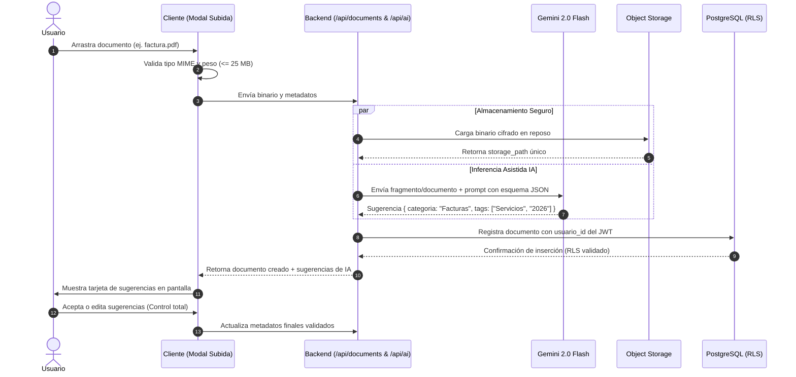

# Arquitectura General del Sistema - DocuSmart

> **Proyecto**: DocuSmart  
> **Patrón**: Arquitectura Web Modular basada en Servicios, Aislamiento RLS y Asistencia por IA  
> **Fecha**: 2026-11-16  

---

## 1. Diagrama de Arquitectura de Capas



---

## 2. Flujo de Datos: Subida y Clasificación Asistida con IA



---

## 3. Pilares de Arquitectura y Seguridad

- **Aislamiento por Row-Level Security (RLS)**: Cada consulta a la base de datos se filtra automáticamente por `usuario_id` del token JWT en el motor SQL.
- **Degradación Elegante del Motor de IA**: Si la API de Google Gemini falla o excede cuota, el archivo se guarda y la interfaz permite clasificar manualmente sin errores críticos.
- **URLs Firmadas Temporales**: El almacenamiento de archivos no es público; el acceso se realiza mediante tokens criptográficos con expiración a los 15 minutos (900 s).

---

## 4. Estructura Física Inicial y Módulos Preparados

Se ha inicializado el proyecto con **Next.js 16 (App Router), TypeScript y Tailwind CSS v4**. Los módulos y contratos técnicos se encuentran organizados y vinculados a las historias de usuario de la siguiente manera:

```text
src/
├── app/
│   ├── layout.tsx                     # Shell global y metadatos de la aplicación
│   ├── page.tsx                       # Dashboard interactivo con navegación y filtros reactivos
│   ├── globals.css                    # Estilos globales y tokens Tailwind v4
│   └── api/                           # Endpoints modulares preparados para HU-01 a HU-08
├── components/                        # Componentes UI implementados:
│   ├── auth/                          # [HU-01] Módulo de Autenticación:
│   │   ├── LoginForm.tsx              # Formulario reactivo de login con Supabase Auth
│   │   └── RegisterForm.tsx           # Formulario reactivo de registro con validaciones
│   ├── explorer/                      # Módulo del Explorador Principal:
│   │   ├── Sidebar.tsx                # [HU-04] Barra lateral con árbol recursivo de carpetas, categorías y cuota dinámica
│   │   ├── TopBar.tsx                 # [HU-06] Barra superior con buscador, usuario autenticado y logout
│   │   ├── FolderModal.tsx            # [HU-04] Modal interactivo de creación y edición de carpetas con paleta de colores
│   │   ├── MoveDocumentModal.tsx      # [HU-04] Modal para reubicar documentos entre carpetas o a la raíz
│   │   ├── DeleteFolderDialog.tsx     # [HU-04] Confirmación de borrado seguro con desvinculación de archivos a la raíz
│   │   ├── DocumentGrid.tsx           # [HU-04, HU-05, HU-06] Vista en cuadrícula con acción para mover a carpetas
│   │   ├── DocumentTable.tsx          # [HU-04, HU-05, HU-06] Vista en tabla con acción para mover a carpetas
│   │   ├── EmptyState.tsx             # [UX] Estados vacíos (sin archivos / sin resultados)
│   │   └── SkeletonLoader.tsx         # [UX] Pantallas de carga esqueletizada (pulse)
│   ├── upload/                        # Módulo de Subida y Asistente IA:
│   │   ├── UploadModal.tsx            # [HU-02, HU-03, HU-04] Modal con subida real, sugerencia IA y selector de carpeta
│   │   └── AiSuggestionCard.tsx       # [HU-03] Tarjeta interactiva con sugerencias de categorías y tags por IA
│   ├── viewer/                        # Módulo de Visualización Segura:
│   │   └── DocumentViewerModal.tsx    # [HU-05, HU-08] Visor de PDF, DOCX, imágenes con metadatos y edición rápida
│   ├── tags/                          # [HU-08] Módulo de pastillas y gestión de etiquetas:
│   │   └── TagInput.tsx               # [HU-08] Selector interactivo de etiquetas (#tags) con autocompletado
│   └── categories/                    # [HU-08] Módulo de categorías personalizadas:
│       └── CategoryModal.tsx          # [HU-08] Modal para crear, editar y eliminar categorías con paleta
├── lib/                               # Servicios de infraestructura y conectores:
│   ├── supabase/                      # Clientes SSR para navegador, servidor y middleware
│   ├── storage/                       # [HU-02, HU-07, HU-08] Validador de 25 MB, extensiones, subida, renombrado y borrado
│   ├── categories/                    # [HU-08] CRUD de categorías personalizadas con Supabase y RLS
│   ├── tags/                          # [HU-08] CRUD de etiquetas y mapeo N:M en document_tags
│   ├── ai/                            # [HU-03, HU-08] Cliente de inferencia Google Gemini Flash con categorías dinámicas
│   ├── folders/                       # [HU-04] CRUD de carpetas, árbol jerárquico, breadcrumbs y anti-ciclos
│   ├── auth/                          # [HU-01] Helpers de sesión y usuario activo
│   └── utils.ts                       # Utilidades de estilos
├── middleware.ts                      # [HU-01] Protección de rutas privadas y refresco de tokens
└── supabase/migrations/
    ├── 001_auth_and_users_rls.sql     # [HU-01] Tabla users y sincronización automática
    ├── 002_documents_storage_and_rls.sql # [HU-02] Tabla documents + Bucket privado 'documents' con RLS
    ├── 003_fix_permissions_and_grants.sql # [HU-02] Concesión de permisos a rol authenticated
    ├── 004_folders_hierarchy_and_rls.sql  # [HU-04] Tabla folders, trigger anti-ciclos y clave foránea con ON DELETE SET NULL
    └── 005_categories_and_tags_rls.sql   # [HU-08] Tablas categories, tags, document_tags con RLS y semillas
```

> **Estado de Implementación**:
> - **HU-01 (Autenticación y Aislamiento de Usuario)**: 🟢 `Validada`. Autenticación con Supabase Auth, middleware de protección de rutas privadas, aislamiento multi-usuario con RLS verificado y formalmente aprobado por el usuario.
> - **HU-02 (Carga y Almacenamiento Seguro de Archivos)**: 🟢 `Validada`. Subida al bucket privado de Supabase Storage (`documents`), validación estricta de 25 MB y tipos MIME, registro de metadatos en tabla `documents` con RLS, y explorador dinámico conectado a documentos reales del usuario. Aprobado formalmente por el usuario tras superar las 6 pruebas reales (P1 a P6).
> - **HU-03 (Clasificación Inteligente con IA)**: 🟢 `Validada`. Inferencia segura en servidor mediante Google Gemini Flash (`gemini-3.1-flash-lite` y fallback automático), respuesta estructurada en JSON (< 1.5 s), tarjeta visual de sugerencias `AiSuggestionCard`, soberanía total de edición y degradación elegante ante indisponibilidad. Aprobada formalmente por el usuario.
> - **HU-04 (Organización mediante Carpetas Jerárquicas)**: 🟢 `Validada`. Creación de carpetas y subcarpetas anidadas, migas de pan (*breadcrumbs*), árbol lateral interactivo, movimiento de documentos entre carpetas, protección anti-ciclos por trigger PostgreSQL y borrado seguro con preservación de archivos en la raíz (`ON DELETE SET NULL`). Aprobada formalmente por el usuario tras superar las 6 pruebas reales (P1 a P6).
> - **HU-05 (Visualizador Integrado de Documentos)**: 🟢 `Validada`. Endpoint `/api/documents/:id/signed-url` para URLs firmadas temporales (15 min), visor PDF embebido, visor de imágenes con zoom, conversión web de .docx con `mammoth`, navegación entre archivos y panel lateral de metadatos. Aprobada formalmente por el usuario tras superar las 5 pruebas reales (P1 a P5).
> - **HU-06 (Búsqueda y Filtros Rápidos en Tiempo Real)**: 🟢 `Validada`. Endpoint `/api/documents/search` con consultas SQL en Supabase protegidas por RLS, hook `useDebounce` (300 ms), filtros compuestos (formato, categoría, fecha, carpeta), barra de chips interactivos y estado vacío explicativo. Aprobada formalmente por el usuario tras superar las 6 pruebas reales (P1 a P6).
> - **HU-07 (Gestión del Archivo: Renombrar, Descargar y Eliminar)**: 🟢 `Validada`. Endpoint `/api/documents/[id]` (PATCH y DELETE dual en PostgreSQL y Supabase Storage), modales de renombrado con preservación de extensión, diálogo modal destructivo de eliminación y descarga directa de binario original vía URL firmada con RLS. Aprobada formalmente por el usuario tras superar las 6 pruebas reales (P1 a P6).
> - **HU-08 (Categorías y Etiquetas Personalizadas)**: 🟢 `Validada`. Implementación y validación completada al 100%. Migración `005_categories_and_tags_rls.sql` ejecutada en Supabase, endpoints `/api/categories` y `/api/tags` protegidos por RLS, componentes `TagInput`, `CategoryModal` y `EditDocumentMetadataModal` integrados en el explorador, categorías dinámicas inyectadas en Google Gemini Flash y pruebas reales (P1 a P6) superadas satisfactoriamente con aprobación formal del usuario.
