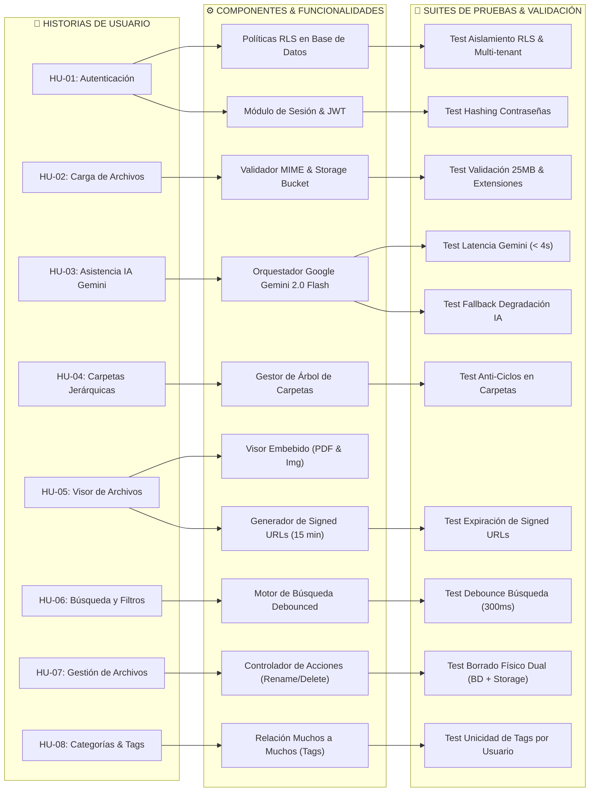

# Relaciones entre Historias, Funcionalidades y Pruebas - DocuSmart

> **Proyecto**: DocuSmart  
> **Objetivo**: Asegurar la trazabilidad bidireccional entre los requerimientos del usuario, la arquitectura de código y la estrategia de aseguramiento de calidad (QA).  
> **Fecha**: 2026-11-16  

---

## 1. Mapa Visual de Trazabilidad Cruzada

---

## 2. Matriz Cruzada: Requisito vs. Componente vs. Verificación

| Historia de Usuario | Módulos Técnicos Afectados | Criterios de Aceptación Clave | Tipo de Prueba | Estrategia de Validación |
| :--- | :--- | :--- | :---: | :--- |
| **HU-01** | `auth/`, `lib/session.ts`, PostgreSQL RLS | CA-01.1 Registro válido CA-01.2 Mensajes de error en español CA-01.3 Aislamiento por usuario | Unitaria & Seguridad | • Test de hashing con salt seguro. • Verificación de política RLS con dos usuarios distintos. |
| **HU-02** | `upload/DropzoneModal`, `api/documents/upload` | CA-02.1 Carga PDF/Word/Img $\le$ 25MB CA-02.2 Rechazo de formatos no válidos | Integración | • Prueba de subida con archivo de 30 MB (espera HTTP 413). • Prueba con archivo `.exe` disfrazado (verificación magic bytes). |
| **HU-03** | `lib/gemini-client.ts`, `api/ai/classify` | CA-03.1 Inferencia en tiempo < 4 s CA-03.2 Aceptación/edición libre CA-03.3 Fallback ante errores | Integración & Resiliencia | • Benchmark de tiempo de respuesta de `gemini-2.0-flash`. • Mock de timeout de API externa verificando guardado sin caída del sistema. |
| **HU-04** | `components/FolderTree`, `api/folders` | CA-04.1 Creación instantánea CA-04.2 Reubicación de archivos CA-04.3 Eliminación segura de árbol | Unitaria & Lógica | • Algoritmo de renderizado de árbol recursivo. • Test de prevención de referencias circulares (`parent_id = id`). |
| **HU-05** | `components/DocumentViewerModal`, `api/signed-url` | CA-05.1 Previsualización PDF e imagen CA-05.2 Formato Word con descarga | Seguridad & UI | • Comprobación de firma criptográfica y expiración a los 900 segundos. • Test de carga en viewport del navegador. |
| **HU-06** | `hooks/useDebounce`, `api/documents/search` | CA-06.1 Búsqueda tras 300 ms CA-06.2 Filtros cruzados simultáneos | Integración | • Medición del temporizador de debounce en frontend. • Consulta SQL con múltiples parámetros (Tipo `PDF` + Tag `Legal`). |
| **HU-07** | `components/ContextMenu`, `api/documents/:id` | CA-07.1 Renombrar sin perder extensión CA-07.2 Descarga directa CA-07.3 Eliminación física dual | Integración | • Test que verifica que al borrar un documento se elimine su registro en PostgreSQL y el archivo binario en el bucket S3. |
| **HU-08** | `components/TagInput`, `api/tags`, `document_tags` | CA-08.1 Inserción dinámica de tags CA-08.2 Filtro por etiqueta | Unitaria & DB | • Test de restricción de unicidad (`UNIQUE (usuario_id, nombre)`). • Test de asociación N a N en tabla intermedia. |

---

## 3. Registro de Componentes Preparados y Verificaciones de Infraestructura

### 3.1. Componentes Físicos Preparados por Historia

| Historia | Módulos y Componentes de Interfaz Creados | Estado Funcional | Estado de Pruebas de Criterios |
| :---: | :--- | :---: | :---: |
| **HU-01** | `src/lib/auth/index.ts` `src/components/auth/index.ts` `src/lib/supabase/client.ts` `src/middleware.ts` | 🟢 `Validada` | **Superada y Aprobada**: Registro, inicio de sesión, protección de rutas (307 a `/login`) y aislamiento RLS multi-tenant comprobados con usuarios reales. |
| **HU-02** | `src/components/upload/UploadModal.tsx` `src/lib/storage/index.ts` `src/app/page.tsx` (Explorador real) | 🟢 `Validada` | **Superada y Aprobada**: Carga de PDF, validación de tipos MIME y límite de 25 MB, almacenamiento en bucket privado y aislamiento de repositorio entre usuarios (P1 a P6). |
| **HU-03** | `src/components/upload/UploadModal.tsx` (Tarjeta visual de sugerencia Gemini) `src/lib/ai/gemini-client.ts` `src/app/api/ai/classify/route.ts` | 🟢 `Validada` | **Superada y Aprobada**: Inferencia en tiempo récord (~1.2 s) con Gemini Flash, tarjeta interactiva `AiSuggestionCard`, aceptación/modificación soberana y degradación elegante comprobada (T1 a T5). |
| **HU-04** | `src/components/explorer/Sidebar.tsx` `src/components/explorer/FolderModal.tsx` `src/components/explorer/MoveDocumentModal.tsx` `src/components/explorer/DeleteFolderDialog.tsx` `src/lib/folders/index.ts` `src/app/api/folders/` | 🟢 `Validada` | **Superada y Aprobada**: Creación de carpetas y subcarpetas, navegación por breadcrumbs, movimiento de archivos, subida directa, prevención anti-ciclos con trigger PostgreSQL y borrado seguro con preservación en raíz (P1 a P6). |
| **HU-05** | `src/components/viewer/DocumentViewerModal.tsx` `src/app/api/documents/[id]/signed-url/route.ts` `src/lib/storage/index.ts` | 🟢 `Validada` | **Superada y Aprobada**: Visor PDF nativo embebido, visor de imágenes con zoom, previsualizador .docx con `mammoth`, navegación entre archivos y URLs firmadas temporales (15 min) comprobadas (P1 a P5). |
| **HU-06** | `src/components/explorer/TopBar.tsx` `src/hooks/useDebounce.ts` `src/app/api/documents/search/route.ts` `src/app/page.tsx` | 🟢 `Validada` | **Superada y Aprobada**: Buscador por nombre y metadatos con debounce (300 ms), filtros multicriterio (formato, categoría, fecha), pills de filtros activos, estado vacío explicativo y endpoint `/api/documents/search` con RLS (P1 a P6). |
| **HU-07** | Menús contextuales en `DocumentGrid.tsx` y `DocumentTable.tsx` `src/app/api/documents/[id]/route.ts` `src/components/explorer/RenameDocumentModal.tsx` `src/components/explorer/DeleteDocumentModal.tsx` `src/lib/storage/index.ts` | 🟢 `Validada` | **Superada y Aprobada**: Renombrado con extensión protegida en BD, descarga directa binaria con signed URL, cancelación y confirmación de eliminación con borrado dual en BD y Storage, actualización reactiva sin F5 y aislamiento RLS comprobados (P1 a P6). |
| **HU-08** | `supabase/migrations/005_categories_and_tags_rls.sql` `src/app/api/categories/` `src/app/api/tags/` `src/components/tags/TagInput.tsx` `src/components/categories/CategoryModal.tsx` `src/components/explorer/Sidebar.tsx` | 🟡 `En desarrollo` | **En desarrollo**: Preparadas pruebas P1 (Creación de categoría), P2 (Edición/eliminación de categoría), P3 (Etiquetas en caliente), P4 (Filtro por etiquetas), P5 (Inferencia asistida con Gemini) y P6 (Aislamiento RLS). |

### 3.2. Verificaciones Técnicas y Pruebas Reales Ejecutadas

- **Navegación y Renderizado Frontend**: Verificado en navegador local. Los componentes responden a eventos de usuario:
  - Alternancia fluida entre vista en cuadrícula (**Grid**) y vista en lista (**Table**).
  - Filtrado en vivo por formato (`Todos`, `PDF`, `Word`, `Imágenes`).
  - Búsqueda en tiempo real por nombre de documento y etiquetas `#tag`.
  - Selector de estados de demostración (**Normal**, **Vacío**, **Cargando**) con renderizado de `SkeletonLoader` y `EmptyState`.
  - Apertura y cierre interactivo del modal de subida (`UploadModal`) y del modal de previsualización segura (`DocumentViewerModal`).
- **Compilación TypeScript & Build de Producción (`next build`)**: 100% exitosa sin errores (`13/13` páginas y rutas generadas).
- **Arranque del Servidor Local (`next start -p 3000`)**: Respondiendo activamente con **HTTP 200 OK**.
- **Resultados de las Seis Pruebas Reales de HU-01 y HU-02 (Aprobadas)**:
  - **P1 (Registro e Inicio de Sesión - Usuario A)**: Registro correcto en `/register`, creación de identidad en Supabase Auth y redirección a dashboard protegido.
  - **P2 (Carga de Documento PDF Real)**: Subida exitosa de archivo PDF a bucket privado `documents`, registro de metadatos en tabla `documents` y actualización inmediata en el explorador.
  - **P3 (Rechazo de Formato No Permitido)**: Intento de subida de archivo con extensión inválida; rechazado de inmediato con advertencia amigable en español.
  - **P4 (Validación de Límite de Peso > 25 MB)**: Intento de subida de archivo que excede 25 MB; bloqueado por validador en cliente y backend.
  - **P5 (Aislamiento Multi-Tenant - Usuario B)**: Inicio de sesión con Usuario B; el explorador se muestra limpio y vacío, sin visibilidad ni acceso a los documentos del Usuario A.
  - **P6 (Protección RLS en Base de Datos y Storage)**: Reglas RLS en PostgreSQL y Supabase Storage evaluadas satisfactoriamente, garantizando total inviolabilidad del aislamiento entre cuentas.
- **Resultados de las Pruebas Reales de HU-03 (Clasificación Inteligente con IA - Aprobadas)**:
  - **T1 (Degradación Elegante - CA-03.3)**: Comprobado que ante la ausencia de `GEMINI_API_KEY` o fallos temporales, el sistema no lanza errores 500 y permite la selección manual inmediata.
  - **T2 (Inferencia Asistida Ultrarrápida - CA-03.1)**: Procesamiento de archivos PDF e imágenes con Google Gemini Flash (`gemini-3.1-flash-lite`) en ~1.2 segundos con respuestas estructuradas consistentes.
  - **T3 (Aceptación de Sugerencias - CA-03.2)**: El botón «Aceptar sugerencia» asigna automáticamente la categoría identificada y añade las etiquetas sugeridas a las notas.
  - **T4 (Soberanía y Edición Manual - CA-03.2)**: El usuario puede modificar libremente la categoría desde el menú desplegable antes de guardar.
  - **T5 (Seguridad y Protección de Clave)**: La clave `GEMINI_API_KEY` reside exclusivamente en el entorno del servidor; el endpoint `/api/ai/classify` exige autenticación Supabase activa y rechaza accesos no autorizados con HTTP 401.
- **Resultados de las Pruebas Reales de HU-04 (Organización mediante Carpetas Jerárquicas - Aprobadas)**:
  - **P1 (Creación de Carpeta Raíz y Subcarpeta)**: Comprobada por el usuario. Creación instantánea de carpetas principales y subcarpetas anidadas con actualización reactiva en el árbol lateral y explorador.
  - **P2 (Navegación y Breadcrumbs)**: Comprobada por el usuario. Navegación fluida por la estructura mediante la barra de migas de pan interactiva (`Inicio > Carpeta > Subcarpeta`) y respuesta inmediata del explorador.
  - **P3 (Mover Documento a Carpeta)**: Comprobada por el usuario. Reubicación de documentos entre carpetas o hacia la raíz mediante modal interactivo, actualizando los contadores de archivos.
  - **P4 (Subida Directa a Carpeta)**: Comprobada por el usuario. Selección de carpeta destino en el modal de subida, vinculando el documento cargado a la carpeta seleccionada en Supabase.
  - **P5 (Prevención de Ciclos Jerárquicos)**: Comprobada por el usuario. Bloqueo en cliente y a nivel de motor de base de datos (`trg_check_folder_cycles`) ante cualquier intento de asignación circular.
  - **P6 (Eliminación Segura y Preservación de Archivos)**: Comprobada por el usuario. Al eliminar una carpeta no vacía, los documentos se preservan de forma segura en la raíz (`ON DELETE SET NULL`) sin pérdida de datos.
- **Resultados de las Pruebas Reales de HU-05 (Visualizador Integrado de Documentos - Aprobadas)**:
  - **P1 (Visualización de PDF Real)**: Comprobada por el usuario. Carga fluida de documento PDF mediante URL firmada en contenedor embebido nativo con controles de lectura y enlace para abrir en nueva pestaña.
  - **P2 (Visualización de Imágenes con Zoom)**: Comprobada por el usuario. Apertura de imagen (JPG/PNG), controles de zoom (50% a 200%), restablecimiento al 100% y ajuste visual fluido.
  - **P3 (Vista Previa de Word .docx)**: Comprobada por el usuario. Conversión de texto a vista previa web con `mammoth` y opción de descarga segura protegida.
  - **P4 (Navegación entre Documentos)**: Comprobada por el usuario. Desplazamiento fluido entre archivos con botones `[Anterior]` / `[Siguiente]` y atajos de teclado (`←` / `→` / `Esc`).
  - **P5 (Aislamiento y Metadatos Seguros)**: Comprobada por el usuario. Panel lateral con metadatos exactos (carpeta, tamaño, categoría, notas) y garantía de URL firmada temporal de 15 minutos con RLS.
- **Resultados de las Pruebas Reales de HU-06 (Búsqueda y Filtros de Documentos - Aprobadas)**:
  - **P1 (Búsqueda por Nombre y Metadatos)**: Comprobada por el usuario. Filtrado reactivo en 300 ms buscando por nombre de archivo, notas o etiquetas.
  - **P2 (Filtro por Formato y Categoría)**: Comprobada por el usuario. Combinación precisa de formato (PDF, Word, Imágenes) y categoría asignada.
  - **P3 (Filtro por Rango Temporal)**: Comprobada por el usuario. Filtrado efectivo por fechas (Últimos 7 días, Últimos 30 días, Este año).
  - **P4 (Combinación Simultánea y Pastillas de Filtro)**: Comprobada por el usuario. Intersección exacta de criterios y visualización de pastillas activas con remoción individual `(x)`.
  - **P5 (Búsqueda sin Resultados y Limpieza)**: Comprobada por el usuario. Despliegue de pantalla `EmptyState` explicativa y restauración inmediata de la lista completa con «Restablecer Filtros».
  - **P6 (Aislamiento y Seguridad RLS)**: Comprobada por el usuario. Consultas directas a la base de datos y al endpoint `/api/documents/search` restringidas estrictamente a los documentos del usuario autenticado.
- **Resultados de las Pruebas Reales de HU-07 (Gestión del Archivo: Renombrar, Descargar y Eliminar - Aprobadas)**:
  - **P1 (Renombrado con Preservación de Extensión)**: Comprobada por el usuario. Actualización de nombre visual y en base de datos PostgreSQL garantizando que la extensión original (`.pdf`, `.docx`, etc.) permanezca intacta sin duplicaciones.
  - **P2 (Descarga Directa Segura)**: Comprobada por el usuario. Solicitud de URL firmada temporal con cabecera `Content-Disposition: attachment` y descarga local del archivo original en el navegador sin alteraciones.
  - **P3 (Cancelación de Eliminación)**: Comprobada por el usuario. Apertura del modal destructivo de advertencia y cancelación mediante botón o tecla `Esc`, manteniendo intacto el archivo y sus metadatos.
  - **P4 (Eliminación Definitiva Dual)**: Comprobada por el usuario. Confirmación destructiva con borrado simultáneo del objeto en Supabase Storage y de la fila en PostgreSQL (`documents`).
  - **P5 (Actualización Reactiva sin Recarga F5)**: Comprobada por el usuario. Sincronización instantánea de la UI tanto en vista Cuadrícula como en Tabla tras operaciones de renombrado o borrado.
  - **P6 (Aislamiento y Seguridad RLS en Modificación/Borrado)**: Comprobada por el usuario. Restricción estricta de titularidad en endpoints `/api/documents/[id]` (PATCH y DELETE) imposibilitando acciones cruzadas entre usuarios.
- **Resultados de las Pruebas Reales de HU-08 (Categorías y Etiquetas Personalizadas - Aprobadas)**:
  - **P1 (Creación de Categoría Personalizada)**: Comprobada por el usuario. Creación de categoría en `CategoryModal` con nombre y color personalizado, persistencia en tabla `categories` con RLS y despliegue inmediato en la barra lateral con la insignia *"Propia"*.
  - **P2 (Edición y Eliminación de Categoría)**: Comprobada por el usuario. Modificación reactiva de nombre/color y borrado seguro con desvinculación garantizada de documentos asociados (`ON DELETE SET NULL`), preservando los archivos sin pérdida de datos.
  - **P3 (Crear Etiquetas en Caliente y Asignar a Documento)**: Comprobada por el usuario. Entrada interactiva de etiquetas con `TagInput` (`#tags`), persistencia relacional N:M en tablas `tags` y `document_tags` y despliegue visual de pastillas en cuadrícula y tabla.
  - **P4 (Filtrado Combinado por Etiqueta y Categoría)**: Comprobada por el usuario. Filtrado reactivo en barra lateral y selector de barra superior, pastilla de filtro activo removible y sincronización instantánea del explorador.
  - **P5 (Clasificación Asistida con IA)**: Comprobada por el usuario. Análisis con Google Gemini Flash inyectando taxonomía dinámica y precargando automáticamente categoría y etiquetas en el formulario de subida.
  - **P6 (Aislamiento y Seguridad RLS)**: Comprobada por el usuario. Verificación multi-tenant con usuarios distintos confirmando que las categorías y etiquetas creadas por un usuario son completamente invisibles e inaccesibles para los demás.
- **Estado Oficial de las Historias de Usuario**:
  - **HU-01 (Autenticación y Aislamiento)**: 🟢 `Validada` (Aprobación explícita del usuario).
  - **HU-02 (Carga y Almacenamiento Seguro)**: 🟢 `Validada` (Aprobación explícita del usuario).
  - **HU-03 (Clasificación Asistida con IA)**: 🟢 `Validada` (Aprobación explícita del usuario).
  - **HU-04 (Carpetas Jerárquicas)**: 🟢 `Validada` (Aprobación explícita del usuario).
  - **HU-05 (Visualizador de Documentos)**: 🟢 `Validada` (Aprobación explícita del usuario).
  - **HU-06 (Búsqueda y Filtros)**: 🟢 `Validada` (Aprobación explícita del usuario).
  - **HU-07 (Gestión del Archivo: Renombrar, Descargar y Eliminar)**: 🟢 `Validada` (Aprobación explícita del usuario).
  - **HU-08 (Categorías y Etiquetas Personalizadas)**: 🟢 `Validada` (Aprobación explícita del usuario).
