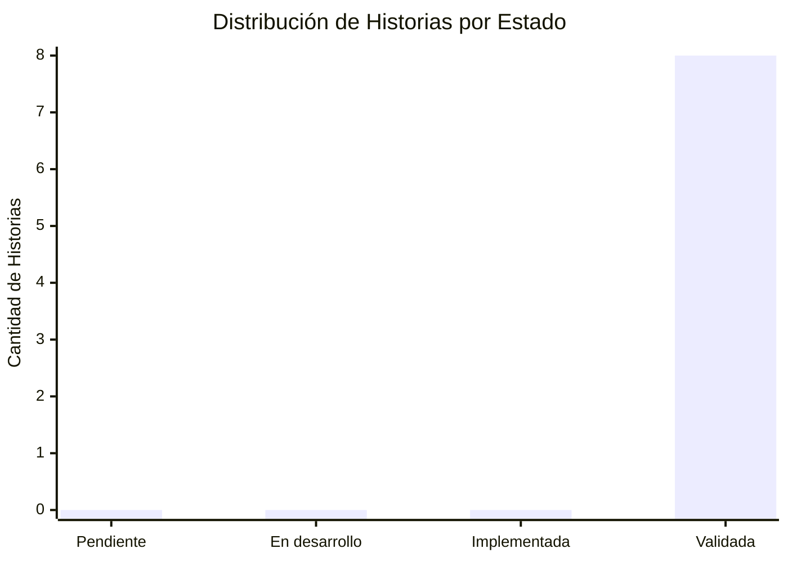

# Tablero de Historias de Usuario y Progreso - DocuSmart

> **Proyecto**: DocuSmart  
> **Fecha de Actualización**: 2026-11-18  
> **Estado General**: MVP 100% Completado y Validado - 8 Historias Validadas (100%) / 0 En desarrollo (0%) / 0 Pendientes (0%)

---

## 1. Métricas de Progreso del MVP

- **Total de Historias**: 8 historias (7 *Must have*, 1 *Should have*)
- **Historias Validadas**: 8 / 8 (100%) - **HU-01**, **HU-02**, **HU-03**, **HU-04**, **HU-05**, **HU-06**, **HU-07** y **HU-08** (Aprobadas formalmente por el usuario tras superar rigurosamente todas sus pruebas reales de verificación funcional y seguridad)
- **Historias Implementadas**: 0 / 8 (0%)
- **Historias En Desarrollo**: 0 / 8 (0%)
- **Historias Pendientes**: 0 / 8 (0%)

---

## 2. Tablero Visual (Flujo Kanban)

```mermaid
flowchart LR
    subgraph PENDIENTE ["📋 PENDIENTE (0)"]
        emptyP["<i>Sin elementos pendientes</i>"]
    end

    subgraph DESARROLLO ["⚙️ EN DESARROLLO (0)"]
        emptyD["<i>Sin elementos en desarrollo</i>"]
    end

    subgraph IMPLEMENTADA ["🧪 IMPLEMENTADA (0)"]
        emptyI["<i>Sin elementos en pruebas</i>"]
    end

    subgraph VALIDADA ["✅ VALIDADA (8)"]
        H1["<b>HU-01</b><br/>Autenticación & RLS<br/><i>(Validada)</i>"]
        H2["<b>HU-02</b><br/>Carga y Almacenamiento<br/><i>(Validada)</i>"]
        H3["<b>HU-03</b><br/>Clasificación IA Gemini<br/><i>(Validada)</i>"]
        H4["<b>HU-04</b><br/>Carpetas Jerárquicas<br/><i>(Validada)</i>"]
        H5["<b>HU-05</b><br/>Visor de Documentos<br/><i>(Validada)</i>"]
        H6["<b>HU-06</b><br/>Búsqueda & Filtros<br/><i>(Validada)</i>"]
        H7["<b>HU-07</b><br/>Gestión del Archivo<br/><i>(Validada)</i>"]
        H8["<b>HU-08</b><br/>Categorías & Tags<br/><i>(Validada)</i>"]
    end

    PENDIENTE -.-> DESARROLLO
    DESARROLLO -.-> IMPLEMENTADA
    IMPLEMENTADA -.-> VALIDADA
```

---

## 3. Detalle de Tarjetas de Historias

| ID | Historia de Usuario | Prioridad | Dependencias Clave | Estado |
| :---: | :--- | :---: | :--- | :---: |
| **HU-01** | **Autenticación y Aislamiento de Usuario** Registro, login seguro con Supabase Auth y activación de Row-Level Security (RLS). | `Must have` | Base de datos & Tabla `users` | 🟢 `Validada` |
| **HU-02** | **Carga y Almacenamiento Seguro de Archivos** Subida arrastrar/soltar de PDF, Word e imágenes $\le$ 25 MB a bucket privado de Supabase Storage. | `Must have` | HU-01 (Sesión activa) | 🟢 `Validada` |
| **HU-03** | **Clasificación Inteligente y Sugerencias con IA** Asistente con `gemini-3.1-flash-lite` para sugerir categorías y etiquetas con fallback elegante. | `Must have` | HU-02 (Archivo disponible) | 🟢 `Validada` |
| **HU-04** | **Organización mediante Carpetas Jerárquicas** Creación de carpetas, árbol lateral, breadcrumbs, migración y movimiento seguro de archivos. | `Must have` | HU-01, HU-02 | 🟢 `Validada` |
| **HU-05** | **Visualizador Integrado de Documentos** Visor embebido para PDF, imágenes y .docx mediante URLs firmadas temporales (15 min). | `Must have` | HU-02 (Storage path) | 🟢 `Validada` |
| **HU-06** | **Búsqueda y Filtros Rápidos en Tiempo Real** Buscador con debounce (300 ms), filtros compuestos (formato, categoría, fecha) y RLS. | `Must have` | HU-02, HU-04 | 🟢 `Validada` |
| **HU-07** | **Gestión del Archivo (Renombrar, Descargar y Eliminar)** Operaciones CRUD sobre archivos con confirmación destructiva y borrado en bucket. | `Must have` | HU-02, HU-05 | 🟢 `Validada` |
| **HU-08** | **Gestión de Categorías y Etiquetas Personalizadas** Creación de categorías y etiquetas dinámicas, edición, filtros y taxonomía con Gemini. | `Should have` | HU-01, HU-03 | 🟢 `Validada` |

---

> **Control de Calidad y Trazabilidad del MVP**: Las **8 historias de usuario** (**HU-01** a **HU-08**) se encuentran **Validadas (100%)** con aprobación formal del usuario tras superar satisfactoriamente todas sus respectivas pruebas funcionales y de seguridad. El ciclo de desarrollo del Producto Mínimo Viable (MVP) de DocuSmart ha concluido exitosamente.
