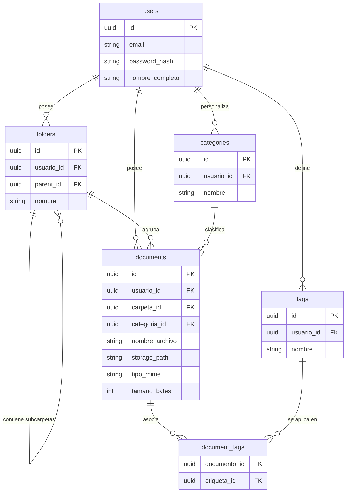
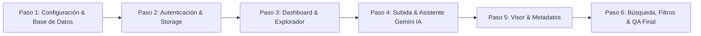

# Documento Maestro de Especificación y Planificación

> **Proyecto**: DocuSmart  
> **Tipo de Aplicación**: Aplicación Web de Gestión Documental Inteligente  
> **Estado**: En Desarrollo Activo - 3 Historias Validadas (HU-01, HU-02, HU-03) / 5 Pendientes  
> **Versión de Planificación**: 1.0.0  
> **Fecha de Actualización**: 2026-11-16

---

## 1. Resumen Ejecutivo

**DocuSmart** es una plataforma web moderna e intuitiva diseñada para organizar, gestionar y centralizar documentos personales y profesionales (archivos PDF, documentos Word e imágenes). Resuelve la dispersión cotidiana de archivos y la pérdida de tiempo asociada a la catalogación manual mediante una combinación de organización por carpetas, categorías, etiquetas y un asistente integrado con Inteligencia Artificial (**Google Gemini 2.0 Flash**) que sugiere de forma instantánea y privada la clasificación del documento al ser subido.

La solución ha sido concebida bajo estrictos principios de seguridad y privacidad: aislamiento garantizado a nivel de base de datos (*Row-Level Security*), almacenamiento cifrado de objetos con URLs temporales firmadas (*Signed URLs*) y una experiencia de usuario ágil, limpia y sin tecnicismos innecesarios.

---

## 2. Índice de Documentación Detallada

Los documentos modulares específicos que componen el análisis se encuentran disponibles en:

- 📄 [01 - Núcleo y MVP](./01-nucleo-y-mvp.md): Propósito, problema, público objetivo y límites del Producto Mínimo Viable.
- 📄 [02 - Experiencia de Usuario (UX)](./02-experiencia-usuario-ux.md): Roles, mapa de navegación, flujos de interacción y pantallas clave.
- 📄 [03 - Requisitos de Calidad](./03-requisitos-de-calidad.md): Rendimiento, seguridad, cifrado, tolerancia a fallos y restricciones.
- 📄 [04 - Datos y Tecnología](./04-datos-y-tecnologia.md): Diagrama Entidad-Relación, stack tecnológico seleccionado y modelo de IA.
- 📄 [05 - Historias de Usuario](./05-historias-de-usuario.md): Historias ágiles HU-01 a HU-08 con criterios de aceptación verificables.

---

## 3. Síntesis Articulada del Proyecto

### 3.1. Núcleo y Alcance del MVP
- **Formatos admitidos**: PDF (`.pdf`), Word (`.docx`, `.doc`), Imágenes (`.png`, `.jpg`, `.jpeg`).
- **Operaciones del ciclo de vida**: Subida rápida (arrastre y selección), renombrado en caliente, previsualización en navegador, descarga original y eliminación con diálogo de seguridad.
- **Estructura organizativa**: Carpetas jerárquicas con subcarpetas, categorías taxonómicas y etiquetas libres (*tags*).
- **Asistencia IA**: Inferencia automática sobre el documento para sugerir categoría y etiquetas; el usuario siempre tiene el control final para validar, modificar o descartar la sugerencia.
- **Fuera del MVP para versiones futuras**: Búsqueda por OCR en texto completo de escaneos, control de revisiones/versiones, carpetas colaborativas compartidas y app móvil nativa.

### 3.2. Experiencia de Usuario (UX)
- **Roles**: Usuario Propietario (acceso completo a su repositorio personal) y Usuario Visitante (inicio de sesión / registro).
- **Dashboard Central**:
  - *Barra lateral*: Árbol de carpetas, categorías con colores y accesos rápidos (*Todos, Recientes, Favoritos*).
  - *Barra superior*: Buscador interactivo en vivo, selector de vista (cuadrícula/lista), pastillas de filtros por formato y botón `+ Subir Documento`.
  - *Área de contenido*: Visualización limpia con menús contextuales rápidos (`...`).
- **Modal de Subida Asistida**: Zona *drag & drop*, análisis visual en progreso y panel de sugerencias de IA con aceptación en 1 clic.
- **Visor Embebido**: Visualización fluida de PDF e imágenes sin descarga obligatoria, con panel lateral de metadatos y edición en el sitio.

### 3.3. Requisitos de Calidad y No Funcionales
- **Rendimiento**: Carga inicial < 2 s, filtros y búsqueda < 300 ms, sugerencia de IA entre 2 y 4 s, previsualización de archivos < 1.5 s.
- **Seguridad y Privacidad**:
  - Aislamiento total de datos por usuario (`usuario_id`).
  - Cifrado en tránsito (HTTPS / TLS 1.3) y en reposo (AES-256).
  - Enlaces de archivos protegidos: **URLs firmadas temporales** con validez de 15 minutos; no existen rutas públicas estáticas.
  - Privacidad de IA: Uso exclusivo de APIs comerciales sin retención de datos para entrenamiento.
- **Tolerancia a Fallos**: Degradación elegante de la IA (si el servicio externo falla, el archivo se guarda y se permite la clasificación manual sin interrumpir el flujo).

### 3.4. Arquitectura de Datos y Stack Tecnológico
- **Frontend**: Next.js (React) + TypeScript + Tailwind CSS + Visor de PDF (`react-pdf`).
- **Backend & Base de Datos**: PostgreSQL con Supabase (o API Routes dedicadas) aprovechando **Row-Level Security (RLS)** para aislamiento estricto por usuario.
- **Almacenamiento de Objetos**: Object Storage compatible con S3 (cifrado en reposo, generación de URLs firmadas).
- **Modelo de IA Vigente**: **`gemini-2.0-flash`** oficial de Google, seleccionado por su capacidad nativa multimodal para documentos e imágenes, respuestas estructuradas en JSON estricto (`response_schema`), bajísima latencia (1-2 s) y garantía empresarial de privacidad.

---

## 4. Historias de Usuario con Criterios de Aceptación (Fase 5 Consolidada)

### HU-01: Autenticación y Aislamiento de Usuario
- **Historia**: *Como usuario, quiero registrarme e iniciar sesión con mi correo electrónico y contraseña para acceder a mi repositorio personal de documentos con total privacidad.*
- **Prioridad**: **Must have**
- **Estado**: 🟢 `Validada` (Aprobación explícita del usuario tras pruebas de autenticación y aislamiento RLS)
- **Criterios de Aceptación**:
  - [x] **Escenario 1 (Registro exitoso)**:
    - **Dado** que el usuario ingresa un correo válido y una contraseña que cumple los requisitos mínimos (8+ caracteres, combinación de letras y números),
    - **Cuando** presiona "Registrarse",
    - **Entonces** se crea su cuenta, se cifra la contraseña mediante un algoritmo seguro (*bcrypt/Argon2*), se inicia sesión y se le redirige al explorador principal vacío.
  - [x] **Escenario 2 (Validación de errores)**:
    - **Dado** que el usuario ingresa un correo ya registrado o datos inválidos,
    - **Cuando** intenta enviar el formulario,
    - **Entonces** el sistema muestra un mensaje de error claro en español junto al campo afectado sin recargar la página.
  - [x] **Escenario 3 (Aislamiento de sesión)**:
    - **Dado** que un usuario inicia sesión,
    - **Cuando** consulta carpetas o archivos,
    - **Entonces** el sistema solo consulta y devuelve registros vinculados a su identificador de usuario (`usuario_id`), impidiendo cualquier acceso a documentos ajenos.

---

### HU-02: Carga y Almacenamiento Seguro de Archivos
- **Historia**: *Como usuario autenticado, quiero subir documentos PDF, Word e imágenes arrastrándolos o seleccionándolos desde mi equipo para centralizarlos en la nube.*
- **Prioridad**: **Must have**
- **Estado**: 🟢 `Validada` (Aprobación explícita del usuario tras pruebas de carga P1-P6 y aislamiento de storage)
- **Criterios de Aceptación**:
  - [x] **Escenario 1 (Subida válida)**:
    - **Dado** que el usuario selecciona un archivo con formato permitido (`.pdf`, `.docx`, `.doc`, `.png`, `.jpg`, `.jpeg`) menor o igual a 25 MB,
    - **Cuando** confirma la subida,
    - **Entonces** el archivo se almacena en el almacenamiento de objetos cifrado y sus metadatos se registran en la base de datos asociados al usuario.
  - [x] **Escenario 2 (Restricción de formato o peso)**:
    - **Dado** que el usuario intenta subir un archivo con extensión no permitida (ej. `.exe`) o que supera los 25 MB,
    - **Cuando** suelta el archivo o lo selecciona,
    - **Entonces** el sistema rechaza la carga inmediatamente y muestra una alerta amigable explicando el motivo y los límites admitidos.

---

### HU-03: Clasificación Inteligente y Sugerencias con IA
- **Historia**: *Como usuario, quiero que la aplicación analice el documento al subirlo y me sugiera automáticamente una categoría y etiquetas relevantes para catalogarlo sin esfuerzo manual.*
- **Prioridad**: **Must have**
- **Estado**: 🟢 `Validada` (Aprobación explícita del usuario tras pruebas funcionales, inferencia ultrarrápida con Gemini Flash, aceptación/modificación y degradación elegante)
- **Criterios de Aceptación**:
  - [x] **Escenario 1 (Sugerencia asistida exitosa)**:
    - **Dado** que el usuario sube un archivo (ej. una factura en PDF),
    - **Cuando** el modelo `gemini-2.0-flash` procesa el documento en un tiempo inferior a 4 segundos,
    - **Entonces** el modal de subida presenta una tarjeta con la categoría sugerida (ej. *"Facturas & Recibos"*) y etiquetas sugeridas (ej. *"Servicios"*, *"2026"*, *"Electricidad"*).
  - [x] **Escenario 2 (Control del usuario sobre la IA)**:
    - **Dado** que el sistema muestra sugerencias de la IA,
    - **Cuando** el usuario revisa los campos,
    - **Entonces** puede aceptar las sugerencias con un solo clic o editar manualmente la categoría y etiquetas antes de presionar "Guardar".
  - [x] **Escenario 3 (Degradación elegante ante fallos)**:
    - **Dado** que el servicio de IA no responde o se agota la cuota externa,
    - **Cuando** finaliza la subida del archivo,
    - **Entonces** el sistema guarda el archivo sin error, notifica discretamente que la sugerencia automática no está disponible y permite al usuario categorizarlo manualmente.

---

### HU-04: Organización mediante Carpetas Jerárquicas
- **Historia**: *Como usuario, quiero crear carpetas y mover archivos entre ellas para mantener una estructura documental limpia y comprensible.*
- **Prioridad**: **Must have**
- **Criterios de Aceptación**:
  - [x] **Escenario 1 (Creación de carpeta)**:
    - **Dado** que el usuario hace clic en "Nueva Carpeta",
    - **Cuando** escribe un nombre (ej. *"Contratos Laborales"*) y confirma,
    - **Entonces** la carpeta se visualiza de inmediato en el árbol lateral y en el panel central.
  - [x] **Escenario 2 (Mover documento a carpeta)**:
    - **Dado** un documento ubicado en la raíz o en otra carpeta,
    - **Cuando** el usuario lo arrastra a una carpeta o selecciona "Mover a..." desde el menú de opciones (`...`),
    - **Entonces** el archivo actualiza su `carpeta_id` y pasa a mostrarse dentro de la carpeta destino.
  - [x] **Escenario 3 (Eliminación de carpeta)**:
    - **Dado** que el usuario solicita eliminar una carpeta que contiene documentos,
    - **Cuando** confirma la acción en el diálogo de advertencia,
    - **Entonces** se maneja la reubicación segura o eliminación controlada de sus elementos según la preferencia seleccionada.

---

### HU-05: Visualizador Integrado de Documentos
- **Historia**: *Como usuario, quiero previsualizar mis archivos directamente en la aplicación para consultar su contenido rápidamente sin necesidad de descargarlos a mi equipo.*
- **Prioridad**: **Must have**
- **Criterios de Aceptación**:
  - [x] **Escenario 1 (Previsualización de PDF e Imágenes)**:
    - **Dado** que el usuario hace clic sobre un archivo PDF o una imagen en la lista,
    - **Cuando** se genera la URL firmada temporal con expiración de 15 minutos,
    - **Entonces** se abre el visor modal mostrando el documento con controles de zoom, cambio de página y un panel lateral con sus metadatos.
  - [x] **Escenario 2 (Documentos Word)**:
    - **Dado** que el usuario abre un archivo `.docx`,
    - **Cuando** interactúa con el visor,
    - **Entonces** se muestra una vista previa formateada o la opción directa de descarga segura.

---

### HU-06: Búsqueda y Filtros Rápidos en Tiempo Real
- **Historia**: *Como usuario, quiero buscar documentos por texto y filtrarlos por categoría, formato o etiquetas para localizar cualquier archivo en segundos.*
- **Prioridad**: **Must have**
- **Criterios de Aceptación**:
  - [x] **Escenario 1 (Búsqueda por texto)**:
    - **Dado** que el usuario escribe un término en la barra de búsqueda (ej. *"alquiler"*),
    - **Cuando** transcurren 300 ms sin escribir (*debounce*),
    - **Entonces** el explorador filtra y muestra únicamente los documentos cuyo nombre contenga el término buscado.
  - [x] **Escenario 2 (Filtros por formato y categoría)**:
    - **Dado** que el usuario activa el filtro rápido `[PDF]` y selecciona la categoría *"Legal"*,
    - **Cuando** se actualiza la vista,
    - **Entonces** se listan exclusivamente los archivos que cumplen ambas condiciones simultáneamente.

---

### HU-07: Gestión del Archivo (Renombrar, Descargar y Eliminar)
- **Historia**: *Como usuario, quiero renombrar mis archivos, descargarlos a mi equipo o eliminarlos definitivamente para mantener mi catálogo actualizado.*
- **Prioridad**: **Must have**
- **Criterios de Aceptación**:
  - [x] **Escenario 1 (Renombrar documento)**:
    - **Dado** que el usuario selecciona "Renombrar" desde el menú del archivo,
    - **Cuando** ingresa el nuevo nombre y confirma,
    - **Entonces** el nombre visible del archivo se actualiza en pantalla y en la base de datos, conservando su extensión original.
  - [x] **Escenario 2 (Descarga directa)**:
    - **Dado** que el usuario pulsa "Descargar",
    - **Cuando** se solicita el archivo,
    - **Entonces** el navegador inicia la descarga del binario original mediante una URL firmada de descarga segura.
  - [x] **Escenario 3 (Eliminación con confirmación)**:
    - **Dado** que el usuario selecciona "Eliminar",
    - **Cuando** aparece el diálogo de confirmación y el usuario pulsa "Confirmar eliminación",
    - **Entonces** el registro se elimina de la base de datos, se borra el archivo del almacenamiento de objetos y desaparece de la vista.

---

### HU-08: Gestión de Categorías y Etiquetas Personalizadas
- **Historia**: *Como usuario, quiero crear y gestionar mis propias categorías y etiquetas para clasificar mis documentos según mis propios criterios.*
- **Prioridad**: **Should have**
- **Criterios de Aceptación**:
  - [x] **Escenario 1 (Creación de etiquetas)**:
    - **Dado** que el usuario está editando los metadatos de un archivo o creando una nueva etiqueta,
    - **Cuando** escribe un texto nuevo (ej. *"Hacienda2026"*) y presiona Enter,
    - **Entonces** la etiqueta queda registrada en su catálogo personal y queda vinculada al documento.
  - [x] **Escenario 2 (Filtro por etiqueta)**:
    - **Dado** que el usuario hace clic en una pastilla de etiqueta en el panel de filtros,
    - **Cuando** se aplica el filtro,
    - **Entonces** se muestran todos los archivos que tienen asociada dicha etiqueta.

---

## 5. Hoja de Ruta de Implementación (Roadmap Recomendado)

1. **Fase de Setup e Infraestructura**:
   - Inicializar el proyecto con Next.js (TypeScript, Tailwind CSS).
   - Configuración de la base de datos PostgreSQL y aplicación de migraciones de tablas (`users`, `folders`, `categories`, `documents`, `tags`, `document_tags`).
   - Habilitar directivas de seguridad **Row-Level Security (RLS)** en todas las tablas.
2. **Fase de Autenticación y Storage**:
   - Implementar vistas de Login y Registro (HU-01).
   - Configurar el bucket privado de almacenamiento de archivos con políticas de acceso y generador de URLs firmadas temporales.
3. **Fase de Explorador y Navegación**:
   - Construir la interfaz de Dashboard (Barra lateral de carpetas y categorías, vista en cuadrícula y lista).
   - Implementar creación y navegación de carpetas (HU-04).
4. **Fase de Subida y Conexión con IA**:
   - Desarrollar el modal de subida con zona *drag & drop* y validación de tipos MIME / peso máximo (HU-02).
   - Integrar la API de **Google Gemini 2.0 Flash** con esquema de respuesta JSON para sugerir automáticamente categoría y etiquetas (HU-03).
5. **Fase de Visualización y Gestión de Archivos**:
   - Integrar visor embebido para PDFs e imágenes (HU-05).
   - Implementar acciones de renombrado, descarga y eliminación segura (HU-07) y gestión de etiquetas (HU-08).
6. **Fase de Búsqueda, Filtros y Pruebas**:
   - Conectar barra de búsqueda con debounce y filtros compuestos en vivo (HU-06).
   - Validación integral de criterios de aceptación de HU-01 a HU-08.

---

## 6. Lista de Verificación y Estado del Desarrollo

- [x] Idea inicial clarificada y delimitada.
- [x] Alcance del MVP definido sin sobrecarga de funcionalidades.
- [x] Flujos e interfaces conceptuales aprobados en la Fase UX.
- [x] Criterios de seguridad, privacidad y aislamiento por usuario establecidos.
- [x] Modelo de datos normalizado con diagrama ER validado.
- [x] Stack tecnológico confirmado (Next.js, Tailwind, PostgreSQL con RLS, Storage con Signed URLs).
- [x] Modelo de IA verificado y vigente (**Google Gemini 2.0 Flash**).
- [x] 8 Historias de Usuario detalladas con criterios de aceptación en formato Dado/Cuando/Entonces.
- [x] Credenciales y variables de entorno configuradas con proyecto real de Supabase (`.env.local`).
- [x] Migraciones aplicadas en Supabase (`001_auth_and_users_rls.sql`, `002_documents_storage_and_rls.sql`, `003_fix_permissions_and_grants.sql`, `004_folders_hierarchy_and_rls.sql`, `005_categories_and_tags_rls.sql`).
- [x] **HU-01: Autenticación y Aislamiento de Usuario**: Implementada, verificada y **Validada** con aprobación explícita del usuario.
- [x] **HU-02: Carga y Almacenamiento Seguro de Archivos**: Implementada, verificada (pruebas P1 a P6) y **Validada** con aprobación explícita del usuario.
- [x] **HU-03: Clasificación Inteligente y Sugerencias con IA**: Implementada, verificada y **Validada** con aprobación explícita del usuario.
- [x] **HU-04: Organización mediante Carpetas Jerárquicas**: Implementada, verificada (pruebas P1 a P6: creación, navegación, movimiento, subida directa, anti-ciclos y eliminación segura) y **Validada** con aprobación explícita del usuario.
- [x] **HU-05: Visualizador Integrado de Documentos**: Implementada, verificada (pruebas P1 a P5: visor PDF nativo, visor de imágenes con zoom, conversión web de .docx con mammoth, navegación entre archivos y URLs firmadas de 15 min con RLS) y **Validada** con aprobación explícita del usuario.
- [x] **HU-06: Búsqueda y Filtros Rápidos en Tiempo Real**: Implementada, verificada (pruebas P1 a P6: búsqueda textual con debounce de 300 ms, filtros de formato, categoría y fecha, combinación simultánea, chips interactivos, estado vacío explicativo y consultas seguras en backend con RLS) y **Validada** con aprobación explícita del usuario.
- [x] **HU-07: Gestión del Archivo (Renombrar, Descargar y Eliminar)**: Implementada, verificada (pruebas P1 a P6: renombrado con extensión protegida, descarga directa binaria con signed URL, diálogo modal de confirmación/cancelación destructiva, borrado dual en PostgreSQL y Supabase Storage, actualización reactiva instantánea del explorador y aislamiento estricto por RLS) y **Validada** con aprobación explícita del usuario.
- [x] **HU-08: Gestión de Categorías y Etiquetas Personalizadas**: Implementada, verificada (pruebas P1 a P6: creación de categorías personalizadas con paleta de colores, edición/borrado seguro, creación de etiquetas en caliente con TagInput, filtrado reactivo cruzado en sidebar y topbar, inyección taxonómica dinámica en Google Gemini Flash y aislamiento estricto por RLS) y **Validada** con aprobación explícita del usuario.
